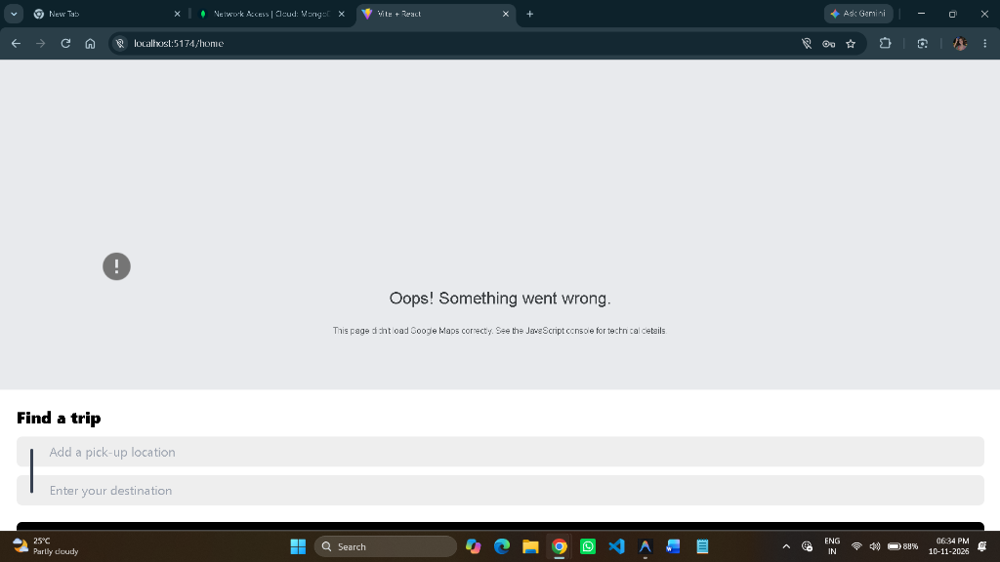
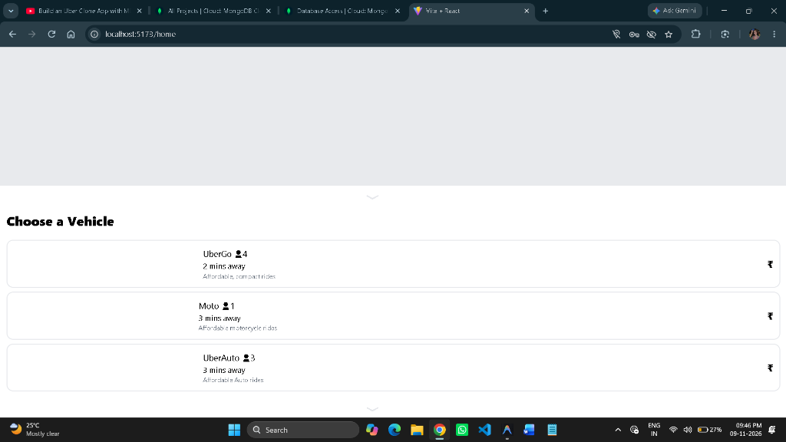
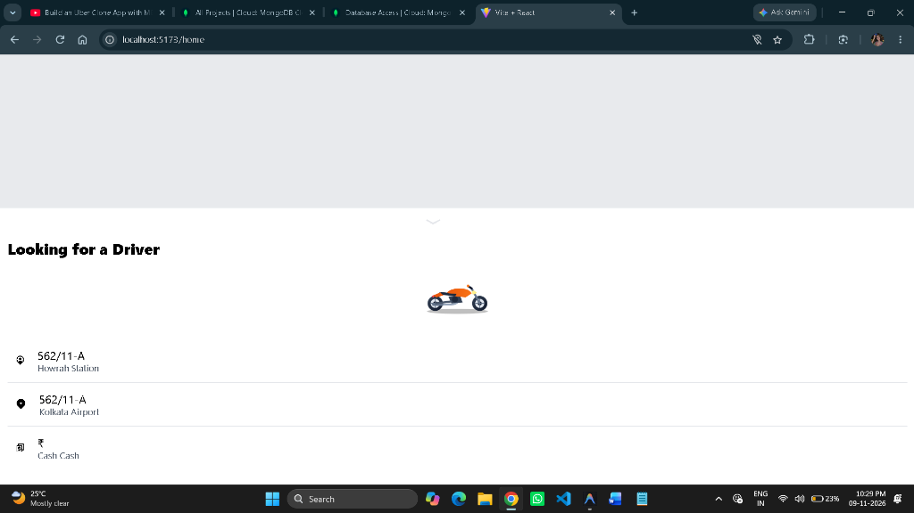
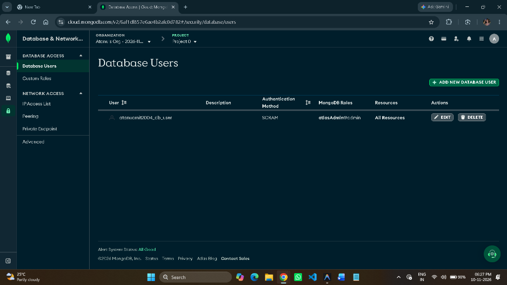
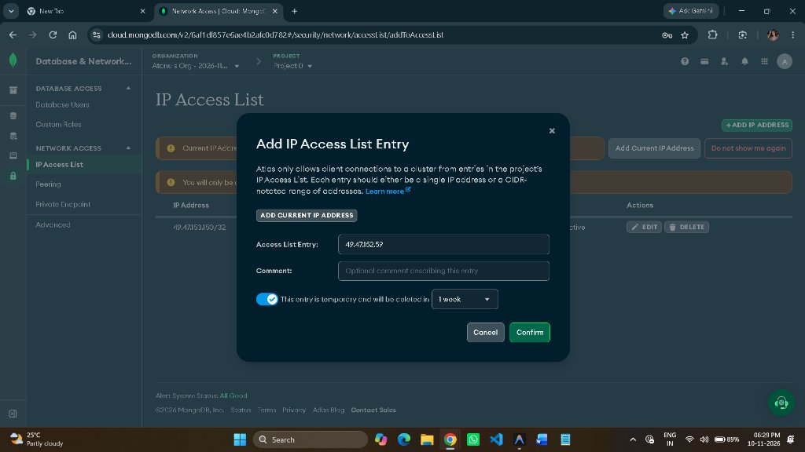

# 🚗 Uber Clone Application

A full-stack, real-time ride-booking application built with **React**, **Node.js**, **Express**, **MongoDB Atlas**, and **Socket.io**. Features complete ride lifecycle handling: user booking, fare estimation, real-time driver ride requests, OTP verification, live GPS map tracking, and ride completion.

---

## 📸 Application Demo & Walkthrough

Here is the complete step-by-step lifecycle from **User Ride Booking** to **Captain Ride Completion**:

### 1. Find a Trip (Pickup & Destination)
User selects their pickup location and destination. Dynamic fare calculation estimates trip cost and travel duration.
<p align="center">
  
</p>

---

### 2. Choose Vehicle Category
Choose between **UberGo** (Car), **UberMoto** (Motorcycle), or **UberAuto** (Auto Rickshaw) with real-time dynamic pricing for each vehicle class.
<p align="center">
  
</p>

---

### 3. Confirm Your Ride
Review trip details, destination address, and fare payment mode (Cash/Card) before requesting a driver.
<p align="center">
  
</p>

---

### 4. Captain Accepts Ride & OTP Verification
The ride request is pushed instantly to active captains via Socket.io. Once the captain accepts, the user receives driver details and a unique **6-digit OTP**. The captain must enter this OTP to start the journey.
<p align="center">
  
</p>

---

### 5. Riding & Trip Completion
Live GPS map tracking during the ongoing trip. Once destination is reached, the captain completes the trip and payment is settled.
<p align="center">
  
</p>

---

## ✨ Features

- **🔐 Authentication & Authorization:**
  - Secure JWT-based authentication for both Users and Captains.
  - Protected routes with custom Auth middlewares.
  - Password hashing using `bcrypt`.

- **📍 Trip Booking & Fare Calculation:**
  - Dynamic fare calculation for multiple vehicle categories: **UberGo (Car)**, **UberMoto (Motorcycle)**, and **UberAuto (Auto Rickshaw)**.
  - Distance & travel time calculation with automatic fallback when Google Maps API quotas or billing are unavailable.

- **⚡ Real-time Socket.io Communication:**
  - Instant ride broadcast notification to active drivers.
  - Driver acceptance notification pushed instantly to the user screen with driver & vehicle details.
  - Real-time ride status transitions (`pending` → `accepted` → `ongoing` → `completed`).

- **🛡️ Secure OTP Verification:**
  - 6-digit random OTP generated upon ride creation.
  - Captain must verify the rider's OTP to transition ride to `ongoing` state.

- **🗺️ Live GPS Tracking:**
  - Interactive map with device geolocation tracking.
  - Integrated OpenStreetMap with real-time coordinate streaming.

- **🎨 Modern Responsive UI:**
  - Sleek Uber-style design using **Tailwind CSS**.
  - Smooth bottom sheets and panel transitions using **GSAP** (`@gsap/react`).
  - High-resolution custom SVG vehicle and map illustrations.
  - Back/Exit navigation buttons on every booking step.

---

## 🛠️ Tech Stack

### Frontend
- **Framework:** React 18 (Vite)
- **Styling:** Tailwind CSS, Remix Icons
- **Animations:** GSAP & `@gsap/react`
- **Realtime:** Socket.io-client
- **HTTP Client:** Axios
- **Routing:** React Router DOM (v6)

### Backend
- **Runtime:** Node.js
- **Framework:** Express.js
- **Database:** MongoDB Atlas (Mongoose ODM)
- **Realtime Engine:** Socket.io
- **Security:** JSON Web Tokens (JWT), bcrypt, cookie-parser, cors

---

## 📂 Project Structure

```text
Uber Clone App/
├── Backend/
│   ├── controllers/         # User, Captain, Ride, and Map controllers
│   ├── db/                  # MongoDB connection logic
│   ├── middlewares/         # JWT authentication middlewares
│   ├── models/              # User, Captain, Ride, and Blacklist schemas
│   ├── routes/              # Express API route definitions
│   ├── services/            # Fare, Map, Ride, and User business logic
│   ├── app.js               # Express application config
│   ├── server.js            # HTTP server & Socket.io initialization
│   ├── socket.js            # Socket event listeners and broadcasters
│   ├── package.json
│   └── .env.example
│
├── Frontend/
│   ├── public/              # Custom vehicle SVGs (car, moto, auto)
│   ├── src/
│   │   ├── components/      # UI panels: VehiclePanel, ConfirmRide, LiveTracking, etc.
│   │   ├── context/         # React Contexts (User, Captain, Socket)
│   │   ├── pages/           # Home, CaptainHome, Login, Signup, Riding pages
│   │   ├── App.jsx          # Route configuration
│   │   └── main.jsx
│   ├── package.json
│   └── .env.example
│
├── .gitignore               # Comprehensive Git ignore rules
└── README.md
```

---

## 🚀 Getting Started

### Prerequisites
- [Node.js](https://nodejs.org/) (v16 or higher)
- [MongoDB Atlas](https://www.mongodb.com/atlas/database) account or local MongoDB instance
- Git

---

### 1. Clone the Repository
```bash
git clone https://github.com/your-username/uber-clone-app.git
cd "Uber Clone App"
```

---

### 2. Backend Setup
1. Open a terminal and navigate to `Backend`:
   ```bash
   cd Backend
   ```
2. Install dependencies:
   ```bash
   npm install
   ```
3. Create `.env` file from `.env.example`:
   ```bash
   cp .env.example .env
   ```
4. Fill in your environment variables:
   ```env
   PORT=4000
   DB_CONNECT=mongodb+srv://<username>:<password>@cluster.mongodb.net/uber-clone?retryWrites=true&w=majority
   JWT_SECRET=your_super_secret_jwt_key
   GOOGLE_MAPS_API=your_google_maps_api_key_optional
   ```
5. Start the backend server:
   ```bash
   npm start
   ```
   *Server will run on `http://localhost:4000` with message `Connected to DB`.*

---

### 3. Frontend Setup
1. Open a new terminal and navigate to `Frontend`:
   ```bash
   cd Frontend
   ```
2. Install dependencies:
   ```bash
   npm install
   ```
3. Create `.env` file from `.env.example`:
   ```bash
   cp .env.example .env
   ```
4. Ensure the API base URL points to your backend:
   ```env
   VITE_BASE_URL=http://localhost:4000
   ```
5. Start the Vite development server:
   ```bash
   npm run dev
   ```
   *Frontend will run on `http://localhost:5173` (or `5174`).*

---

## 🧪 Testing the Complete Ride Flow

To test the real-time ride flow locally on a single machine:

1. **User Window:**
   - Open standard browser window (`http://localhost:5173`).
   - Register or Login as a **User**.
2. **Captain Window:**
   - Open an **Incognito / Private** browser window (`http://localhost:5173`).
   - Register or Login as a **Captain**.
3. **Book Ride:**
   - On the User window, enter Pickup (e.g. `Kolkata Airport`) and Destination (e.g. `Howrah Station`).
   - Click **Find Trip**, select a vehicle (e.g. `Moto`), and click **Confirm Ride**.
4. **Accept & Complete:**
   - The Captain window instantly receives the **"New Ride Available!"** popup.
   - Captain clicks **Accept**.
   - User window immediately displays driver details and a **6-digit OTP**.
   - Captain enters the OTP and clicks **Confirm & Start Ride**.
   - Once reached, Captain clicks **Finish Ride** to complete the journey.

---

## 📡 API Endpoints Summary

### User Routes (`/users`)
| Method | Endpoint | Description | Auth Required |
|---|---|---|---|
| `POST` | `/users/register` | Register new user | No |
| `POST` | `/users/login` | Login user | No |
| `GET` | `/users/profile` | Get user profile | Yes (Bearer Token) |
| `GET` | `/users/logout` | Logout user | Yes (Bearer Token) |

### Captain Routes (`/captains`)
| Method | Endpoint | Description | Auth Required |
|---|---|---|---|
| `POST` | `/captains/register` | Register new captain | No |
| `POST` | `/captains/login` | Login captain | No |
| `GET` | `/captains/profile` | Get captain profile | Yes (Bearer Token) |
| `GET` | `/captains/logout` | Logout captain | Yes (Bearer Token) |

### Ride Routes (`/rides`)
| Method | Endpoint | Description | Auth Required |
|---|---|---|---|
| `POST` | `/rides/create` | Create a new ride booking | Yes |
| `GET` | `/rides/get-fare` | Estimate fare for pickup/dest | Yes |
| `POST` | `/rides/confirm` | Captain accepts ride | Yes |
| `GET` | `/rides/start-ride` | Captain starts ride with OTP | Yes |
| `POST` | `/rides/end-ride` | Captain completes ride | Yes |

---

## 🔌 Socket.io Events

| Event Name | Direction | Payload | Description |
|---|---|---|---|
| `join` | Client → Server | `{ userType, userId }` | Joins user or captain into their respective room |
| `new-ride` | Server → Captain | `ride` object | Broadcasts newly requested ride to drivers |
| `ride-confirmed` | Server → User | `ride` object | Notifies user that driver accepted ride |
| `ride-started` | Server → User | `ride` object | Notifies user that OTP matched and ride began |
| `ride-ended` | Server → User | `ride` object | Notifies user that ride has finished |

---

## 📄 License
This project is open-source and available under the [MIT License](LICENSE).

